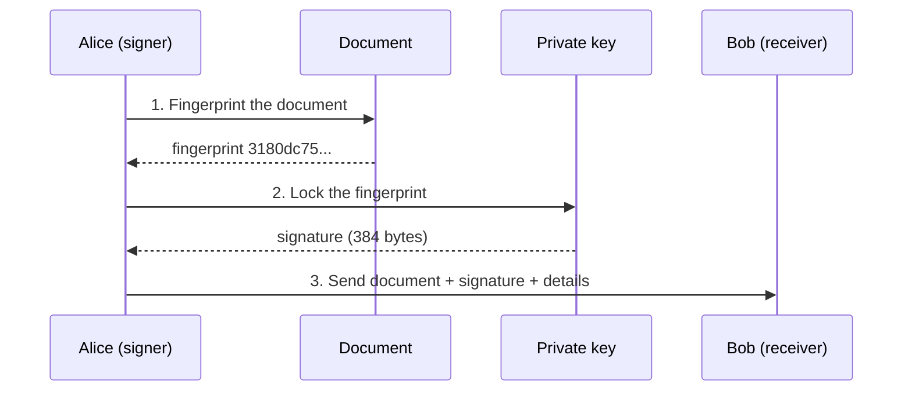
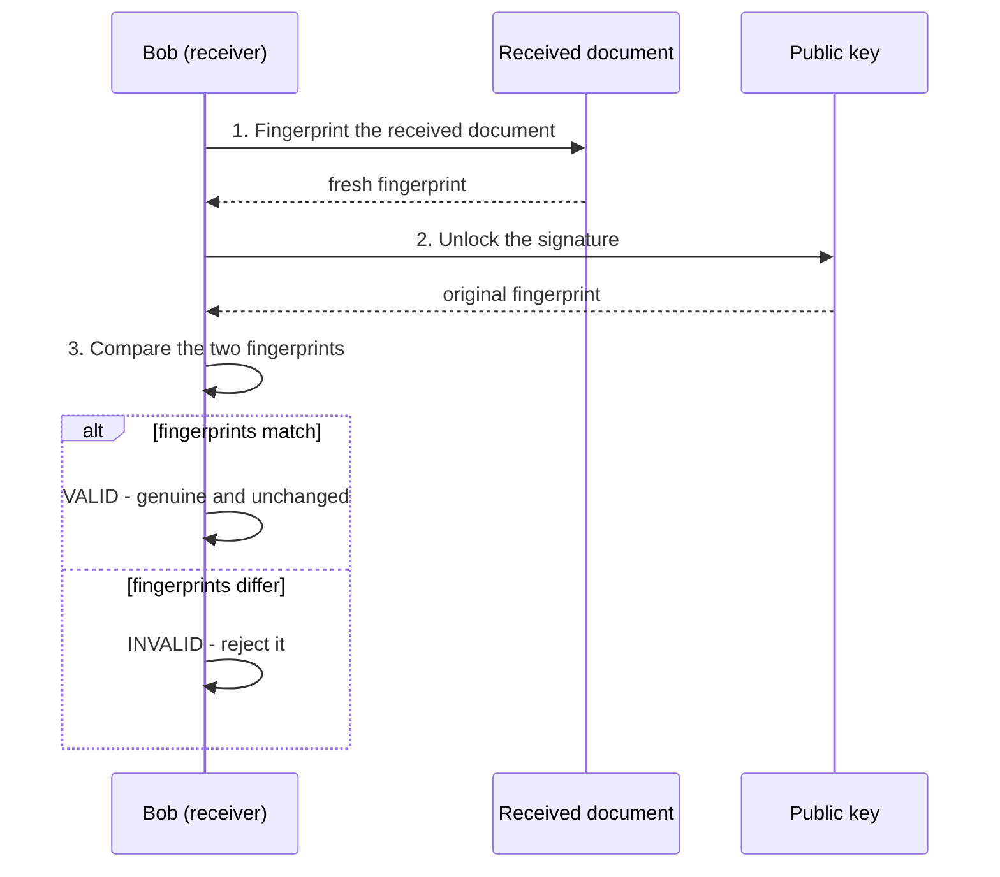
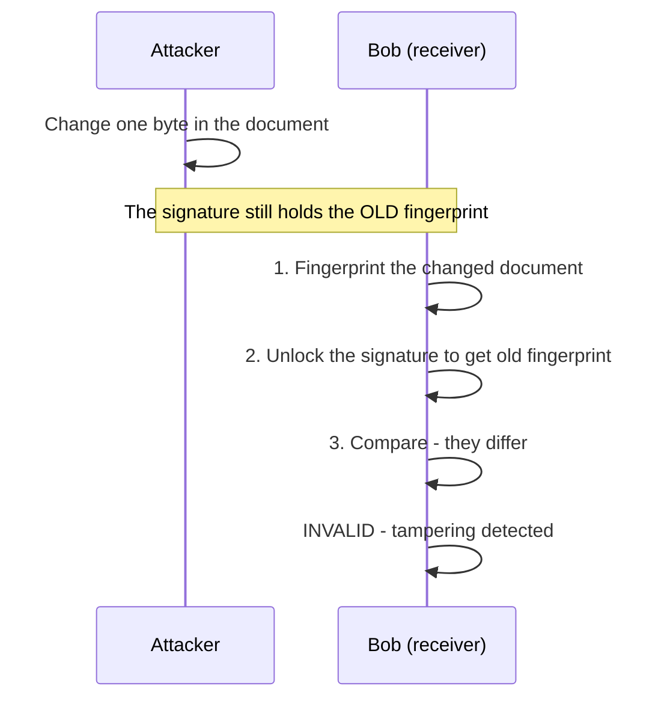
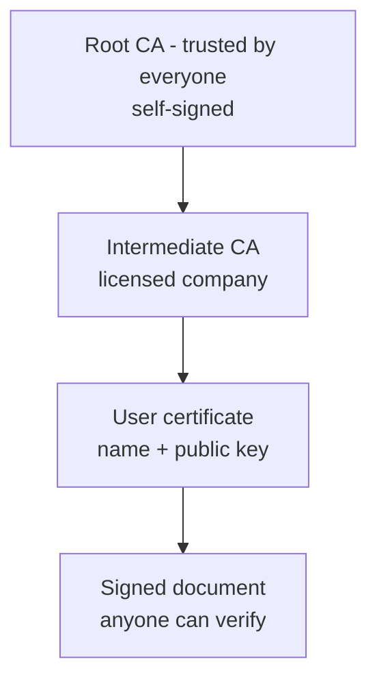

# Digital Signatures Explained

> Audience: managers first, developers second.
> Plain language. Short sentences. Every technical term is explained the first time it appears.

## 1. What problem does this solve?

Anyone can fake a name at the bottom of an email. Anyone can edit a file after you send it. A digital signature fixes both problems at once. It proves **who** sent a document and **that nobody changed it** afterwards.

## 2. Real-world analogy

Think of a wax seal on a royal letter. The seal has two jobs. First, the stamp shows the letter came from the king. Second, the wax cracks if anyone opens the letter. A digital signature is the same idea for computer files. The "stamp" is mathematics instead of wax. It names the sender and it "cracks" if even one byte changes.

## 3. Key concepts in plain English

- **Hash (fingerprint).** A short code computed from a file. Same file, same code. Change one letter, and the code changes completely. Example: a fingerprint identifies a person; a hash identifies a file.
- **Private key.** A secret code that only the signer holds. It creates signatures. Example: the pen only you own, kept in your safe.
- **Public key.** A matching code that anyone may have. It checks signatures. It cannot create them. Example: a padlock you hand out; anyone can lock a box with it, but only your key opens it. (Here the roles are flipped: your private key "locks", everyone's public key "unlocks to check".)
- **Signature.** The file's fingerprint, locked with the private key. It travels with the document. Example: the wax seal pressed onto the letter.
- **Certificate.** A document that says "this public key belongs to Alice", signed by someone trustworthy. Example: a passport for a key.
- **Certificate Authority (CA).** The trusted organisation that issues certificates after checking identity. Example: the passport office for keys.

## 4. How it works, step by step

Signing has three steps. Fingerprint the document. Lock the fingerprint with the private key. Send the document plus the signature.

### Diagram 1: Signing flow



Verification also has three steps. Fingerprint the received document. Unlock the signature with the public key. Compare the two fingerprints.

### Diagram 2: Verification flow



If anyone changes the document after signing, the fresh fingerprint will not match the signed one. Verification fails. That is the whole security guarantee.

### Diagram 3: Tampering scenario



## 5. Trust and certificates

A signature only says "whoever holds this private key signed it". But how does Bob know the public key really belongs to Alice? An attacker could hand Bob a fake key labelled "Alice".

The answer is a **certificate**. A trusted organisation (the CA) checks Alice's identity, then signs a document that binds her name to her public key. Bob trusts the CA's key once, up front. After that he can check any certificate that CA issued. CAs themselves are certified by higher CAs, forming a **chain of trust** up to a **root CA** that everyone trusts.

### Diagram 4: Chain of trust



To verify, Bob walks the chain backwards. He checks the document against the user certificate. Then he checks the user certificate against the intermediate CA. Then he checks the intermediate against the root. If every link holds, he trusts the signature.

## 6. Digital signature vs. electronic signature vs. scanned signature

These three terms are often mixed up. They are very different.

| Aspect | Digital signature | Electronic signature | Scanned signature |
|---|---|---|---|
| What it is | Fingerprint locked with a private key (maths) | Any electronic mark of agreement: typed name, checkbox, drawn squiggle | A photo of ink on paper, pasted into a file |
| Security | Strong: backed by cryptography | Varies: depends on the system around it | None: anyone can copy the image |
| Tamper detection | Yes: any change breaks verification | Only if the platform adds it separately | No: the image stays valid on edited text |
| Legal standing | Strongest: recognised by law when made with a licensed CA certificate | Valid for many agreements, but easier to dispute | Weak: proves nothing about who pasted it |

Rule of thumb: every digital signature is an electronic signature, but most electronic signatures are not digital signatures.

## 7. Algorithms used today

An **algorithm** is the exact mathematical recipe used. Our POC uses RSA-PSS with SHA-256. The common choices today:

- **RSA-PSS.** The classic. Very widely supported. Use it when compatibility matters. Keys are large (3072 bits recommended).
- **ECDSA (P-256).** Same security with much smaller keys. Use it for phones, smart cards, and speed. Harder to implement safely.
- **Ed25519.** Modern, fast, and hard to misuse. Use it for new systems that support it.
- **SHA-256.** The fingerprint recipe used with all of the above. Fast and trusted.

Do not use **MD5** or **SHA-1**. Both are broken. Researchers can forge files with identical MD5 or SHA-1 fingerprints, which destroys the whole guarantee.

## 8. Where digital signatures are used

- **Signed PDFs and contracts.** Agreements that must prove who signed and that the text is unchanged.
- **Software updates and code signing.** Your phone only installs updates signed by the maker. Unsigned updates are rejected.
- **HTTPS/TLS certificates.** The padlock in your browser. Websites prove their identity with certificates.
- **Email (S/MIME).** Signed emails prove the sender and catch tampering in transit.
- **GST and income tax filing.** Indian portals accept filings signed with a DSC as legally valid submissions.
- **eSign (Aadhaar-based).** Sign online using Aadhaar authentication instead of a USB token. See the India section below.

## 9. India context

> This is not legal advice. Rules change. Check with a lawyer or the CCA website before relying on any of this.

Facts verified by web search in November 2026:

- **IT Act 2000 recognition.** The Information Technology Act, 2000 is India's law for electronic records. It recognises digital signatures made with certificates from licensed CAs. Such a signature carries the same legal effect as a handwritten one.
- **CCA and licensed CAs.** The Controller of Certifying Authorities (CCA) is the regulator. It works under the Ministry of Electronics and IT. It operates India's root CA and licenses companies to issue certificates. Licensed CAs include eMudhra, Capricorn, Sify, (n)Code Solutions, NIC, and Protean (formerly NSDL e-Gov). The CCA itself does not sell certificates to the public. You buy from a licensed CA.
- **DSC classes and USB tokens.** A DSC (Digital Signature Certificate) is the certificate on your key. Since January 2021, only **Class 3** DSCs are issued for signing. Class 1 and Class 2 are discontinued. The private key normally lives on a USB token (a small hardware device). You plug it in and enter a PIN to sign. Some CAs now also offer cloud DSCs, where the key stays in the CA's hardware and you approve signing with an OTP.
- **Aadhaar eSign.** An online alternative to the USB token. You authenticate with Aadhaar at the moment of signing. The service creates a one-time signature for that document. Nothing to buy, install, or carry.

## 10. Risks and best practices

| Risk | Impact | Mitigation |
|---|---|---|
| Private key theft | Attacker can sign as you | Keep keys on hardware tokens or an HSM; password-protect files; never email keys |
| Expired or revoked certificate | Signatures stop being trusted | Track expiry dates; check revocation lists (CRL/OCSP) before trusting |
| Weak algorithms (MD5, SHA-1, short RSA keys) | Forged signatures that verify as VALID | Use SHA-256 or better; RSA-3072 minimum; review algorithms yearly |
| Signing without a timestamp | Later disputes about *when* you signed | Use a trusted timestamp authority (TSA) so the time is provable |

## 11. POC overview and results

The POC in `poc/` proves the concept with real cryptography (Python `cryptography` library, RSA-3072-PSS-SHA256):

1. **Key generation.** Creates a password-protected key pair in `keys/`.
2. **Sign.** Fingerprints any file and writes a detached `.sig` file plus a `.meta.json` file (signer, algorithm, timestamp, file hash).
3. **Verify.** Returns a clear VALID or INVALID verdict with a plain-language reason.
4. **Tamper demo.** Changes one byte and shows verification failing.
5. **Demo CA + certificates (stretch).** A tiny local CA issues an X.509 certificate for the signer. Verification uses the key inside the certificate.
6. **PDF signing (stretch).** Signs a PDF with pyHanko and validates it against the demo CA. You can draw your signature with the mouse, like ink on paper. Your drawing appears on the page. Remember: the drawing is for humans only. Verification ignores the picture and checks the mathematics.

Real CLI output from this repo:

```text
$ python cli.py sign samples/sample.txt --signer Alice
1. Hashing document with SHA-256...
   fingerprint: 3180dc750b5a842e7a6d0b0037000d82...
2. Signing hash with private key...
3. Wrote signature: samples/sample.txt.sig (XBunDE453DNS7oeq4WU8EHtvfKDiFzSC...)
4. Wrote metadata:  samples/sample.txt.meta.json
   signer=Alice time=2026-11-18T10:59:21.308393+00:00

$ python cli.py verify samples/sample.txt samples/sample.txt.sig --meta samples/sample.txt.meta.json
1. Hashing received document...
2. Checking signature with public key...
VALID: the file is unchanged and the signature matches this key.

$ python cli.py tamper-demo samples/sample.txt samples/sample.txt.sig --meta samples/sample.txt.meta.json
Tampered copy: samples/sample.txt.tampered (added 1 byte)
Verifying tampered copy against the ORIGINAL signature...
INVALID: the file was changed after signing. Its fingerprint no longer matches the signed fingerprint.
```

Test results: 17 pytest tests pass. They cover the valid round-trip, 1-byte tamper, wrong key, corrupt signature, wrong algorithm, missing files, the certificate chain, and PDF sign/validate including a visible hand-drawn signature. The web UI at `http://127.0.0.1:5000/` shows the same flows in a browser with four tabs: Generate Keys, Sign, Verify, and Sign PDF. Signing never validates by itself: tab 4 only signs, and tab 3 verifies, so the demo matches the real sender/receiver split.

## 12. Glossary and FAQ

**Glossary.** Hash: file fingerprint. Private key: secret signing code. Public key: shared checking code. Signature: locked fingerprint. Certificate: passport for a key. CA: passport office for keys. HSM: tamper-proof box that holds keys. Timestamp: proof of *when* signing happened.

1. **Why not just use a password to prove identity?** Passwords prove who you are to one website. They do not travel with a document. A signature travels with the file and anyone can check it.
2. **Can someone copy my signature onto another document?** No. The signature contains that document's fingerprint. Pasted onto another file, the fingerprints will not match. Verification fails.
3. **What if I lose my private key?** You cannot sign anymore. Get a new certificate. Tell the CA to revoke the old one so nobody trusts it.
4. **What if someone steals my private key?** They can sign as you until the certificate is revoked. This is why keys live on tokens or HSMs, never in email.
5. **How long is a signature valid?** As long as the certificate is valid and the algorithm is trusted. Certificates expire (typically 1-3 years). Old algorithms get retired.
6. **Does signing keep the document secret?** No. A signature proves origin and integrity, not secrecy. Anyone can still read the file. Use encryption for secrecy.
7. **What does a timestamp add?** It proves the signature existed at a certain time. Without it, someone can dispute whether you signed before your certificate expired.
8. **Is a digital signature legally valid in India?** Yes, when made with a DSC from a licensed CA under the IT Act 2000. This is not legal advice. Ask a lawyer for your case.
9. **USB token or Aadhaar eSign?** A token is best for frequent signing. eSign is best for occasional signing with no hardware. Both are recognised.
10. **What does the POC leave out?** Real CA certificates, hardware key storage, timestamps, revocation checks, and audit logs. See Next steps.

## 13. Next steps

What a production version would need:

- **HSM or KMS key storage.** Keys live in tamper-proof hardware (on-premise HSM) or a cloud key service (KMS). They never sit as files on a server.
- **A real CA.** Certificates from a licensed CA (or your company's own properly-run CA), not a demo script.
- **Trusted timestamping.** A timestamp authority (TSA) stamps every signature with provable time.
- **Audit logs.** Who signed what, when, and the result. Stored where nobody can alter them.
- **Revocation checking.** Before trusting a signature, check that the certificate was not revoked (via CRL or OCSP).
