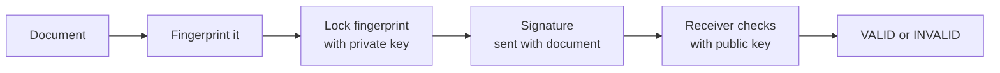

# Executive Summary: Digital Signatures

> Read this in 2 minutes. Demo keys only. Not for production use.

A digital signature proves **who** sent a document and **that nobody changed it**. Think of a wax seal: it names the sender and cracks if the letter is opened.

5 things a manager should know:

1. **It answers two questions.** Who sent this, and is it unchanged? One check gives both answers.
2. **One changed byte breaks it.** Any tampering after signing makes verification fail. That is the security guarantee.
3. **Keys come in pairs.** The private key signs and stays secret. The public key verifies and can be shared freely.
4. **Trust comes from certificates.** A licensed authority (CA) certifies that a public key belongs to a named person. In India this runs under the IT Act 2000.
5. **The POC proves it works.** Sign a file, verify VALID, tamper one byte, see INVALID. Run `poc/README.md` for the 5-minute live demo.

Full story: `digital-signature-explained.md`. Live demo: `poc/README.md`.
